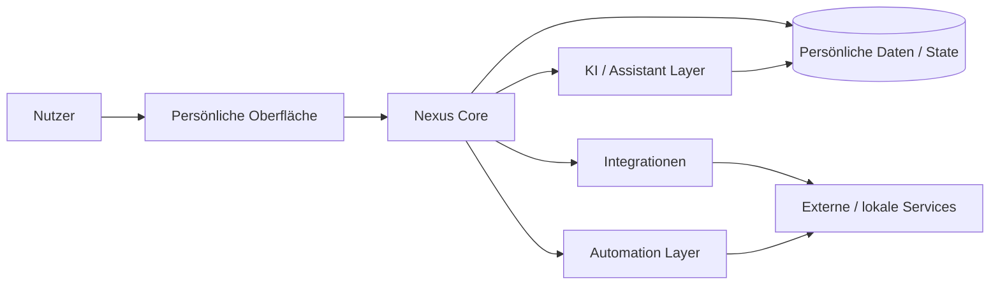

<div align="center">

# Nexus

### Self-hosted persönliche KI- und Life-Management-Plattform


<p><a href="./README.md">English</a> · <a href="./README.de.md"><strong>Deutsch</strong></a> · <a href="./README.tr.md">Türkçe</a></p>

<p>
<a href="https://github.com/tahakubilay"></a>
<a href="https://github.com/tahakubilay/Nexus"></a>


</p>

</div>

---

## ✨ Auf einen Blick

| | |
|---|---|
| 🤖 **Kernidee** | Persönlicher KI-Assistent und Life-Management-Hub |
| 🏠 **Deployment-Modell** | Self-hosted / nutzerkontrollierte Umgebung |
| 🔄 **Automation** | Persönliche Workflows, Services und wiederkehrende Aktionen verbinden |
| 🧩 **Integrationsfokus** | Mehrere Tools und Datenquellen in einer Erfahrung zusammenführen |
| 🔐 **Datenschutzrichtung** | Persönliche Workflows unter der Kontrolle des Nutzers halten |
| 🧠 **Engineering** | Orchestrierung, Integrationen, State, Automation und KI-gestützte Abläufe |

> [!NOTE]
> Nexus ist primär ein **System für den persönlichen Gebrauch** und kein kommerzielles SaaS-Produkt. Dieses Repository wird als Portfolio- und zukünftige Self-Hosting-Referenz vorbereitet.

## 🧭 Schnellnavigation

[Überblick](#überblick) · [Konzept](#kernkonzept) · [Architektur](#high-level-architektur) · [Engineering](#engineering-fokus) · [Roadmap](#projektstatus)

## 🔎 Überblick

Nexus ist eine self-hosted persönliche Plattform, die KI-Unterstützung, Automatisierung und alltägliche digitale Workflows in einer Umgebung zusammenführt.

Statt sich auf einen isolierten Assistenten oder ein einzelnes Utility zu verlassen, soll ein persönliches System entstehen, das mehrere Services und Workflows rund um den Nutzer koordinieren kann.

## 🧠 Kernkonzept

```text
Persönliche Daten
     +
Verbundene Services
     +
Automationsregeln
     +
KI-Unterstützung
     ↓
   Nexus
     ↓
Eine persönliche Betriebsschicht
```

Das langfristige Ziel ist nicht nur Fragen zu beantworten, sondern eine zentrale Schicht bereitzustellen, die Kontext verstehen, Services verbinden und bei wiederkehrenden persönlichen Abläufen unterstützen kann.

## 🏗️ High-Level-Architektur



> [!IMPORTANT]
> Das Diagramm ist bewusst konzeptionell. Konkrete Services, Modelle, Storage, Authentifizierung, lokale Komponenten und Automationsflows werden nach der finalen Codebereinigung dokumentiert.

## ⚡ Was Nexus zusammenführt

| Bereich | Rolle |
|---|---|
| 🤖 **KI-Unterstützung** | Kontextbezogene Hilfe für persönliche Aufgaben und Workflows |
| 🔄 **Automation** | Wiederkehrende Aktionen durch wiederverwendbare Routinen reduzieren |
| 🧩 **Integrationen** | Lokale und externe Services verbinden |
| 🗃️ **Persönlicher Kontext** | Nützlichen Zustand über Workflows hinweg erhalten |
| 🏠 **Self-Hosting** | Kontrolle über Deployment und Systemverhalten behalten |
| 🧭 **Einheitliche Erfahrung** | Verstreute Tools durch eine persönliche Oberfläche ersetzen |
| ⚙️ **Orchestrierung** | KI, Daten, Automationen und Service-Aktionen koordinieren |

## 🧠 Engineering-Fokus

Nexus kombiniert mehrere Software-Themen in einer persönlichen Plattform:

- KI-gestützte Workflows
- Integrationsarchitektur
- Automationsorchestrierung
- Zustandsbehafteter Nutzerkontext
- Lokales / self-hosted Deployment
- Service-Abstraktion
- Koordination von Hintergrundaufgaben
- Datenschutzbewusstes Design
- Erweiterbarkeit

Damit ist Nexus teils persönlicher Assistent, teils Automations-Hub und teils Systemintegrationsplattform.

## 🔐 Datenschutz & Self-Hosting

Die Architektur ist bewusst auf nutzerkontrolliertes Deployment ausgerichtet.

Nicht veröffentlicht werden:

- Persönliche Daten
- Private API-Zugangsdaten
- Reale Service-Tokens
- Private Automation-Secrets
- Persönliche Account-Konfiguration

Eine zukünftige öffentliche Version verwendet stattdessen Beispiele, Templates und sichere Konfigurationsmuster.

## 🎬 Demo / Showcase

Nexus ist nicht dafür gedacht, eine echte persönliche Instanz öffentlich verfügbar zu machen.

Stattdessen wird die Portfolio-Version enthalten:

- Produkt-Screenshots
- Bereinigte Workflow-Beispiele
- Architekturdiagramme
- Beispiel-Automationen
- Setup-Dokumentation
- Geführten Produkt-Walkthrough
- Optionalen Demo-Modus mit synthetischen Daten

## 🖼️ Produktvorschau

| Home / Assistant | Automationen | Integrationen |
|---|---|---|
| 🤖 Demnächst | 🔄 Demnächst | 🧩 Demnächst |

## 🛣️ Projektstatus

- [x] Öffentliches Portfolio-Repository
- [x] Produktpositionierung
- [x] Konzeptionelle Architektur
- [ ] Finale Codebereinigung
- [ ] Konfiguration bereinigen
- [ ] Realen Tech-Stack dokumentieren
- [ ] Screenshots ergänzen
- [ ] Workflow-GIF ergänzen
- [ ] Integrationen dokumentieren
- [ ] Installationsanleitung ergänzen
- [ ] Self-Hosting-Dokumentation veröffentlichen

## 💡 Warum dieses Projekt wichtig ist

Nexus zeigt Arbeit über mehrere Schichten hinweg, die häufig separat gebaut werden.

`AI Systems` · `Automation` · `Self-Hosting` · `Integrations` · `Personal Software` · `System Orchestration`

Die Kernaufgabe ist nicht nur das Bauen einzelner Features, sondern ein System zu entwerfen, in dem viele unterschiedliche Services und Workflows koexistieren können, ohne chaotisch zu werden.

---

<div align="center">

### Entwickelt von [Taha Kubilay](https://github.com/tahakubilay)

</div>