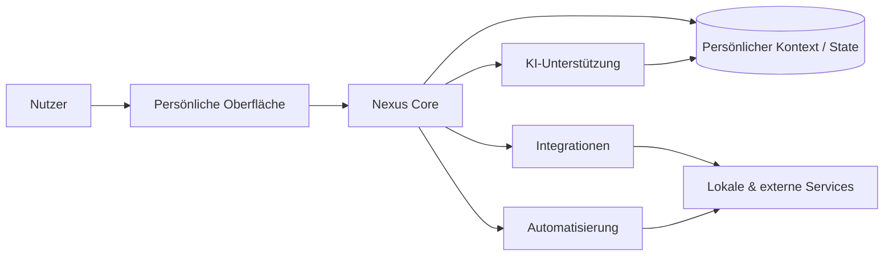

# Nexus

### Self-hosted persönliche KI- und Life-Management-Plattform

<a href="./README.md">English</a> · <a href="./README.de.md"><strong>Deutsch</strong></a> · <a href="./README.tr.md">Türkçe</a>

  
  
  

---

## Überblick

Nexus ist eine self-hosted persönliche KI- und Life-Management-Plattform, die Assistenten, Automatisierung, Integrationen und persönliche Workflows in einer Umgebung zusammenführt.

Die Grundidee: Persönliche Software wird leistungsfähiger, wenn KI-Unterstützung, Kontext, verbundene Services und wiederholbare Abläufe über eine koordinierte Schicht zusammenarbeiten.

## Kernmodell

## Kernfunktionen

| Bereich | Zweck |
|---|---|
| **KI-Unterstützung** | Kontextbezogene Hilfe für persönliche Aufgaben und Workflows |
| **Automatisierung** | Wiederkehrende Aktionen durch wiederverwendbare Routinen reduzieren |
| **Integrationen** | Lokale und externe Services verbinden |
| **Persönlicher Kontext** | Nützlichen Zustand über Workflows hinweg erhalten |
| **Self-Hosting** | Deployment und Systemverhalten unter Nutzerkontrolle halten |
| **Orchestrierung** | KI, Daten, Automatisierung und Service-Aktionen koordinieren |

## Engineering-Fokus

Nexus verbindet mehrere Systemdesign-Themen in einer persönlichen Plattform:

- KI-gestützte Workflows
- Integrationsarchitektur
- Automatisierungsorchestrierung
- Zustandsbehafteter Nutzerkontext
- Self-hosted Deployment
- Service-Abstraktion
- Koordination von Hintergrundaufgaben
- Datenschutzbewusstes Systemdesign
- Erweiterbarkeit

## Datenschutz & Self-Hosting

Nexus ist für nutzerkontrolliertes Deployment gedacht. Persönliche Daten, private API-Zugangsdaten, Service-Tokens und account-spezifische Secrets sind nicht Bestandteil des öffentlichen Repositorys.

---

### Entwickelt von [Taha Kubilay](https://github.com/tahakubilay)

`AI Systems` · `Automation` · `Self-Hosting` · `Integrations` · `System Orchestration`

