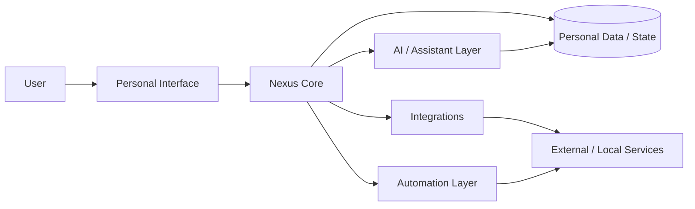

<div align="center">

# Nexus

### Self-hosted personal AI and life management platform


<br/>

[](https://github.com/tahakubilay)
[](https://github.com/tahakubilay/Nexus)


<br/>


</div>

---

## ✨ At a Glance

| | |
|---|---|
| 🤖 **Core Idea** | Personal AI assistant and life-management hub |
| 🏠 **Deployment Model** | Self-hosted / user-controlled environment |
| 🔄 **Automation** | Connect personal workflows, services and recurring actions |
| 🧩 **Integration Focus** | Bring multiple tools and data sources into one experience |
| 🔐 **Privacy Direction** | Keep personal workflows under the user's own control |
| 🧠 **Engineering** | Orchestration, integrations, state, automation and AI-assisted flows |

> [!NOTE]
> Nexus is primarily a **personal-use system**, not a commercial SaaS product. This repository is being prepared as a portfolio and future self-hosting reference.

## 🧭 Quick Navigation

[Overview](#-overview) • [Concept](#-core-concept) • [Architecture](#-high-level-architecture) • [Focus Areas](#-engineering-focus) • [Roadmap](#-project-status)

## 🔎 Overview

Nexus is a self-hosted personal platform designed to bring AI assistance, automation and everyday digital workflows into a single environment.

Instead of relying on one isolated assistant or one-purpose utility, the idea is to create a personal system that can coordinate multiple services and workflows around the user.

## 🧠 Core Concept

```text
Personal Data
     +
Connected Services
     +
Automation Rules
     +
AI Assistance
     ↓
   Nexus
     ↓
One Personal Operating Layer
```

The long-term goal is not just to answer questions, but to provide a central layer that can understand context, connect services and assist with recurring personal workflows.

## 🏗️ High-Level Architecture



> [!IMPORTANT]
> This diagram is intentionally conceptual. Exact services, models, storage, authentication, local components and automation flows will be documented after the final code cleanup.

## ⚡ What Nexus Brings Together

| Area | Role |
|---|---|
| 🤖 **AI Assistance** | Context-aware support for personal tasks and workflows |
| 🔄 **Automation** | Reduce repetitive actions through reusable routines |
| 🧩 **Integrations** | Connect local and external services |
| 🗃️ **Personal Context** | Maintain useful state across workflows |
| 🏠 **Self-Hosting** | Keep control of deployment and system behavior |
| 🧭 **Unified Experience** | Replace scattered utilities with one personal interface |
| ⚙️ **Orchestration** | Coordinate AI, data, automations and service actions |

## 🧠 Engineering Focus

Nexus is interesting because it combines several software concerns in one personal platform:

- AI-assisted workflows
- Integration architecture
- Automation orchestration
- Stateful user context
- Local/self-hosted deployment
- Service abstraction
- Background task coordination
- Privacy-conscious design
- Extensibility

This makes Nexus a different kind of portfolio project: part personal assistant, part automation hub and part systems-integration platform.

## 🔐 Privacy & Self-Hosting

The project is intentionally designed around user-controlled deployment.

The public repository will not include:

- Personal data
- Private API credentials
- Real service tokens
- Private automation secrets
- Personal account configuration

A future public version will use examples, templates and safe configuration patterns instead.

## 🎬 Demo / Showcase

Nexus is not intended to expose a live personal instance publicly.

Instead, the portfolio version will include:

- Product screenshots
- Sanitized workflow examples
- Architecture diagrams
- Example automations
- Setup documentation
- A guided product walkthrough
- Optional demo mode using synthetic data

## 🖼️ Product Showcase

| Home / Assistant | Automations | Integrations |
|---|---|---|
| 🤖 Coming soon | 🔄 Coming soon | 🧩 Coming soon |

A short walkthrough GIF will be added after the public-safe build is finalized.

## 🛣️ Project Status

- [x] Public portfolio repository
- [x] Product positioning
- [x] Conceptual architecture
- [ ] Final code cleanup
- [ ] Sanitize configuration
- [ ] Document real technology stack
- [ ] Add screenshots
- [ ] Add workflow GIF
- [ ] Document integrations
- [ ] Add installation guide
- [ ] Publish self-hosting documentation

## 💡 Why This Project Matters

Nexus demonstrates work across multiple layers that are often built separately.

It combines:

`AI Systems` · `Automation` · `Self-Hosting` · `Integrations` · `Personal Software` · `System Orchestration`

The core challenge is not just building features — it is designing a system where many different services and workflows can coexist without becoming chaotic.

---

<div align="center">

### Built by [Taha Kubilay](https://github.com/tahakubilay)

**Software Engineer · Full-Stack Systems · AI & Automation · Self-Hosted Software**

[⬆ Back to top](#nexus)

</div>