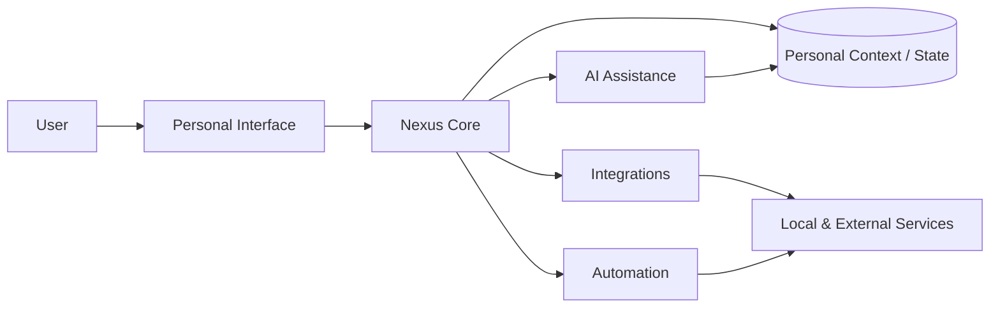

# Nexus

### Self-hosted personal AI and life-management platform

<a href="./README.md"><strong>English</strong></a> · <a href="./README.de.md">Deutsch</a> · <a href="./README.tr.md">Türkçe</a>

  
  
  

---

## Overview

Nexus is a self-hosted personal AI and life-management platform that brings assistants, automation, integrations and personal workflows into a single environment.

The project is designed around a simple idea: personal software becomes more useful when AI assistance, context, connected services and repeatable workflows can operate through one coordinated layer.

## Core Model

## Core Capabilities

| Area | Purpose |
|---|---|
| **AI Assistance** | Provide context-aware support for personal tasks and workflows |
| **Automation** | Reduce repetitive actions through reusable routines |
| **Integrations** | Connect local and external services |
| **Personal Context** | Preserve useful state across workflows |
| **Self-Hosting** | Keep deployment and system behavior under user control |
| **Orchestration** | Coordinate AI, data, automation and service actions |

## Engineering Focus

Nexus combines several system-design concerns in one personal platform:

- AI-assisted workflows
- Integration architecture
- Automation orchestration
- Stateful user context
- Self-hosted deployment
- Service abstraction
- Background task coordination
- Privacy-aware system design
- Extensibility

## Privacy & Self-Hosting

Nexus is intended for user-controlled deployment. Personal data, private API credentials, service tokens and account-specific secrets are not part of the public repository.

---

### Built by [Taha Kubilay](https://github.com/tahakubilay)

`AI Systems` · `Automation` · `Self-Hosting` · `Integrations` · `System Orchestration`

