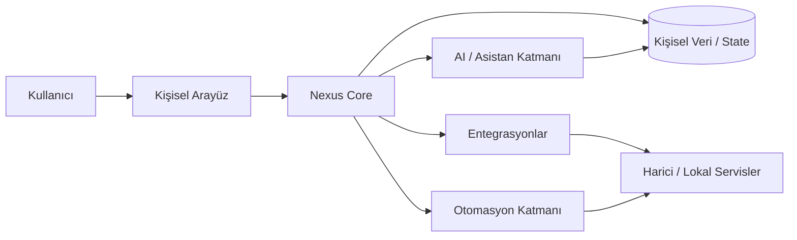

<div align="center">

# Nexus

### Self-hosted kişisel AI ve yaşam yönetim platformu


<p><a href="./README.md">English</a> · <a href="./README.de.md">Deutsch</a> · <a href="./README.tr.md"><strong>Türkçe</strong></a></p>

<p>
<a href="https://github.com/tahakubilay"></a>
<a href="https://github.com/tahakubilay/Nexus"></a>


</p>

</div>

---

## ✨ Kısaca

| | |
|---|---|
| 🤖 **Temel Fikir** | Kişisel AI asistanı ve yaşam yönetim merkezi |
| 🏠 **Deployment Modeli** | Self-hosted / kullanıcı kontrollü ortam |
| 🔄 **Otomasyon** | Kişisel workflow'ları, servisleri ve tekrar eden eylemleri bağlamak |
| 🧩 **Entegrasyon Odağı** | Birden fazla aracı ve veri kaynağını tek deneyimde birleştirmek |
| 🔐 **Gizlilik Yaklaşımı** | Kişisel workflow'ları kullanıcının kendi kontrolünde tutmak |
| 🧠 **Mühendislik** | Orkestrasyon, entegrasyonlar, state, otomasyon ve AI destekli akışlar |

> [!NOTE]
> Nexus öncelikle **kişisel kullanım için tasarlanmış bir sistemdir**, ticari bir SaaS ürünü değildir. Bu repo portföy ve gelecekteki self-hosting referansı olarak hazırlanıyor.

## 🧭 Hızlı Gezinme

[Genel Bakış](#genel-bakış) · [Konsept](#temel-konsept) · [Mimari](#yüksek-seviye-mimari) · [Mühendislik](#mühendislik-odağı) · [Yol Haritası](#proje-durumu)

## 🔎 Genel Bakış

Nexus; AI desteği, otomasyon ve günlük dijital workflow'ları tek bir ortamda bir araya getirmek için tasarlanmış self-hosted kişisel bir platformdur.

Tek bir izole asistana veya tek amaçlı utility'lere bağlı kalmak yerine, kullanıcının çevresindeki farklı servisleri ve workflow'ları koordine edebilen kişisel bir sistem oluşturmayı hedefler.

## 🧠 Temel Konsept

```text
Kişisel Veri
     +
Bağlı Servisler
     +
Otomasyon Kuralları
     +
AI Desteği
     ↓
   Nexus
     ↓
Tek Bir Kişisel İşletim Katmanı
```

Uzun vadeli hedef yalnızca sorulara cevap vermek değil; bağlamı anlayan, servisleri birbirine bağlayan ve tekrar eden kişisel süreçlerde yardımcı olabilen merkezi bir katman oluşturmaktır.

## 🏗️ Yüksek Seviye Mimari



> [!IMPORTANT]
> Bu diyagram bilinçli olarak kavramsaldır. Gerçek servisler, modeller, storage, authentication, local bileşenler ve otomasyon akışları final kod temizliğinden sonra belgelenecektir.

## ⚡ Nexus Neleri Birleştiriyor?

| Alan | Rol |
|---|---|
| 🤖 **AI Desteği** | Kişisel görevler ve workflow'lar için bağlama duyarlı destek |
| 🔄 **Otomasyon** | Tekrar eden işlemleri yeniden kullanılabilir rutinlerle azaltmak |
| 🧩 **Entegrasyonlar** | Lokal ve harici servisleri bağlamak |
| 🗃️ **Kişisel Bağlam** | Workflow'lar boyunca faydalı state'i korumak |
| 🏠 **Self-Hosting** | Deployment ve sistem davranışının kontrolünü kullanıcıda tutmak |
| 🧭 **Birleşik Deneyim** | Dağınık araçları tek kişisel arayüz altında toplamak |
| ⚙️ **Orkestrasyon** | AI, veri, otomasyon ve servis eylemlerini koordine etmek |

## 🧠 Mühendislik Odağı

Nexus tek bir kişisel platform içinde birden fazla yazılım problemini bir araya getirir:

- AI destekli workflow'lar
- Entegrasyon mimarisi
- Otomasyon orkestrasyonu
- State taşıyan kullanıcı bağlamı
- Local / self-hosted deployment
- Servis soyutlama
- Background task koordinasyonu
- Gizlilik odaklı tasarım
- Genişletilebilirlik

Bu nedenle Nexus; bir miktar kişisel asistan, bir miktar otomasyon merkezi ve bir miktar sistem entegrasyon platformudur.

## 🔐 Gizlilik & Self-Hosting

Proje bilinçli olarak kullanıcı kontrollü deployment etrafında tasarlanmıştır.

Public repo şunları içermeyecektir:

- Kişisel veriler
- Özel API kimlik bilgileri
- Gerçek servis token'ları
- Özel otomasyon secret'ları
- Kişisel hesap konfigürasyonu

Gelecekteki public sürüm bunun yerine örnekler, template'ler ve güvenli konfigürasyon kalıpları kullanacaktır.

## 🎬 Demo / Showcase

Nexus gerçek kişisel instance'ı public olarak açmak için tasarlanmamıştır.

Bunun yerine portföy sürümü şunları içerecektir:

- Ürün ekran görüntüleri
- Temizlenmiş workflow örnekleri
- Mimari diyagramlar
- Örnek otomasyonlar
- Kurulum dokümantasyonu
- Rehberli ürün walkthrough
- İsteğe bağlı sentetik verili demo modu

## 🖼️ Ürün Vitrini

| Ana Sayfa / Asistan | Otomasyonlar | Entegrasyonlar |
|---|---|---|
| 🤖 Yakında | 🔄 Yakında | 🧩 Yakında |

## 🛣️ Proje Durumu

- [x] Public portföy reposu
- [x] Ürün konumlandırması
- [x] Kavramsal mimari
- [ ] Final kod temizliği
- [ ] Konfigürasyonu sanitize et
- [ ] Gerçek teknoloji yığınını belgele
- [ ] Ekran görüntülerini ekle
- [ ] Workflow GIF'ini ekle
- [ ] Entegrasyonları belgele
- [ ] Kurulum rehberi ekle
- [ ] Self-hosting dokümantasyonunu yayınla

## 💡 Bu Proje Neden Önemli?

Nexus, normalde ayrı ayrı geliştirilen birden fazla katmanda çalışma deneyimini gösterir.

`AI Systems` · `Automation` · `Self-Hosting` · `Integrations` · `Personal Software` · `System Orchestration`

Temel zorluk yalnızca özellik geliştirmek değil; çok farklı servis ve workflow'un kaosa dönüşmeden birlikte yaşayabileceği bir sistem tasarlamaktır.

---

<div align="center">

### Geliştiren: [Taha Kubilay](https://github.com/tahakubilay)

</div>