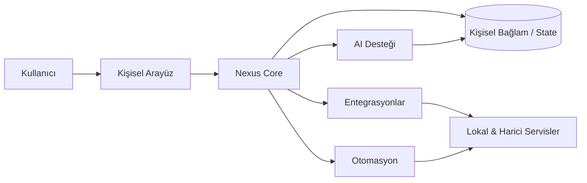

# Nexus

### Self-hosted kişisel AI ve yaşam yönetim platformu

<a href="./README.md">English</a> · <a href="./README.de.md">Deutsch</a> · <a href="./README.tr.md"><strong>Türkçe</strong></a>

  
  
  

---

## Genel Bakış

Nexus; AI asistanlarını, otomasyonu, entegrasyonları ve kişisel workflow'ları tek ortamda birleştiren self-hosted bir kişisel AI ve yaşam yönetim platformudur.

Temel fikir şudur: AI desteği, kişisel bağlam, bağlı servisler ve tekrar eden süreçler tek koordinasyon katmanında çalıştığında kişisel yazılım çok daha kullanışlı hale gelir.

## Temel Model

## Temel Yetenekler

| Alan | Amaç |
|---|---|
| **AI Desteği** | Kişisel görevler ve workflow'lar için bağlama duyarlı yardım |
| **Otomasyon** | Tekrar eden işlemleri yeniden kullanılabilir rutinlerle azaltmak |
| **Entegrasyonlar** | Lokal ve harici servisleri bağlamak |
| **Kişisel Bağlam** | Workflow'lar boyunca faydalı state'i korumak |
| **Self-Hosting** | Deployment ve sistem davranışının kontrolünü kullanıcıda tutmak |
| **Orkestrasyon** | AI, veri, otomasyon ve servis eylemlerini koordine etmek |

## Mühendislik Odağı

Nexus, bir kişisel platform içinde birden fazla sistem tasarımı problemini bir araya getirir:

- AI destekli workflow'lar
- Entegrasyon mimarisi
- Otomasyon orkestrasyonu
- State taşıyan kullanıcı bağlamı
- Self-hosted deployment
- Servis soyutlama
- Background task koordinasyonu
- Gizlilik odaklı sistem tasarımı
- Genişletilebilirlik

## Gizlilik & Self-Hosting

Nexus kullanıcı kontrollü deployment için tasarlanmıştır. Kişisel veriler, özel API kimlik bilgileri, servis token'ları ve hesaba özel secret'lar public repository'nin parçası değildir.

---

### Geliştiren: [Taha Kubilay](https://github.com/tahakubilay)

`AI Systems` · `Automation` · `Self-Hosting` · `Integrations` · `System Orchestration`

